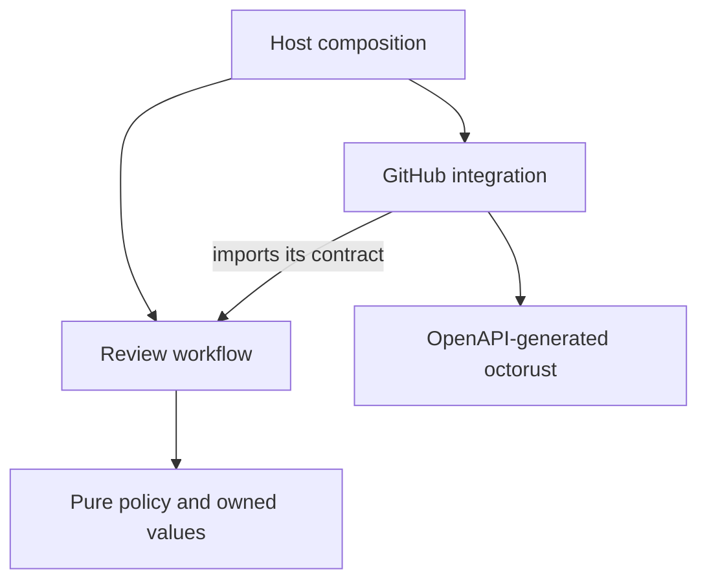

# Review publication: a Rust reference architecture

A hypothetical Statecraft capability: decide whether a review applies to an exact
plan artifact, then publish the feedback as a GitHub conversation comment.
This teaching example is separate from Statecraft's implementation.

```sh
cd examples/review-publication
cargo test --locked
cargo run --locked
# Include the generated GitHub client and its HTTP-fixture tests:
cargo test --locked --all-features
cargo fmt --all --check
cargo clippy --locked --all-targets --all-features -- -D warnings
```

The pinned toolchain is in `rust-toolchain.toml`. The demo is offline; it needs no
credentials and performs no live GitHub writes.

## Read the small reference first

| Module | Responsibility | Reason for the boundary |
| --- | --- | --- |
| `policy.rs` | Owned values and a pure decision | Challenge the rule with ordinary inputs |
| `workflow.rs` | One attempt through the GitHub contract | Make decision handling and external effects explicit |
| `github.rs` | OpenAPI-generated octorust integration | Contain provider types, error classification, and pagination |

The core imports only the standard library. Its `Decision` enum carries either a
skip reason or a prepared publication. The shell matches every variant. Clippy
rejects wildcard enum match arms, keeping new cases visible to consumers.

The GitHub contract is consumer-owned and provider-specific. Runtime control flows
from workflow to integration; the integration imports the workflow's contract.
`github` is an optional Cargo feature so the pure example does not require the SDK.



Arrows show source dependencies. The SQLite journal and formatting/key functions
have no additional traits. Modules are grouped by capability, without a container
or global directories for every architectural layer.

## Durable delivery is an extension

`publish_once` makes one attempt and promises no automatic retry or durability.
`recovery.rs` and the concrete `journal.rs` add those concerns explicitly:

- The destination is canonicalized once for identity, stored request, and delivery.
  Typed request comparison does not depend on JSON property order.
- Existing receipts are checked before current eligibility. A new current plan
  cannot turn an earlier success into a skip.
- The SQLite unique key reserves one writer before the external call. Every
  worker must share the same durable database.
- `Published(NonZeroU64)`, `Rejected { reason }`, and `Unknown { reason }` preserve
  distinct knowledge. A published outcome cannot contain a missing or zero ID.
- A rejected write retains its cause and permits an explicit `retry_rejected`
  after correcting the problem, subject to current eligibility. It is not an
  automatic retry loop.
- Unknown writes are never resent, including through `retry_rejected`. Only
  read-back evidence can confirm them; missing evidence leaves them unknown.
- A crash after reservation but before sending may leave an unsent write unknown
  indefinitely. Automatic eventual delivery is deliberately not promised.

The journal reads structured request values before comparing them. The marker
binds destination and immutable review identity; changed plan/content requires a
new review identity. Its hash length prefixes use fixed-width integers so keys
are stable across platforms.

The offline demo simulates a provider accepting a comment and losing its response,
repeats the request, reads back evidence, and finishes with one created comment.
Reconciliation checks the entire body and configured publisher account across all
pages. A copied marker by another author is not evidence of our publication.

## Real integration

The adapter uses octorust 0.10.0, generated from GitHub's OpenAPI description.
Its default retry middleware is disabled in Cargo. The production constructor
uses a bounded timeout and disables redirects. There is no handwritten HTTP client.

```rust
let github = GitHub::new(token, configured_publisher_user_id)?;
let journal = PublicationJournal::open("reviews.sqlite")?;
```

The host supplies the token through its credential mechanism and verifies the
publisher's identity. Host authentication, authorization, input validation,
current-plan lookup, diagnostics, and database operations remain host concerns.
The demo does not read environment credentials or offer a live-post command.

Tests cover the policy, the simple shell, durable outcomes after restart and plan
changes, normalized identities, competing connections, and the generated client's
actual HTTP behavior against a local fixture. They do not establish live GitHub
behavior or durability under real disk failure.

This capability publishes feedback identifying the reviewed artifact. It does not
authorize or apply infrastructure; applying a plan needs a binding to the exact
artifact at execution. Deleting or losing journal records loses deduplication.
