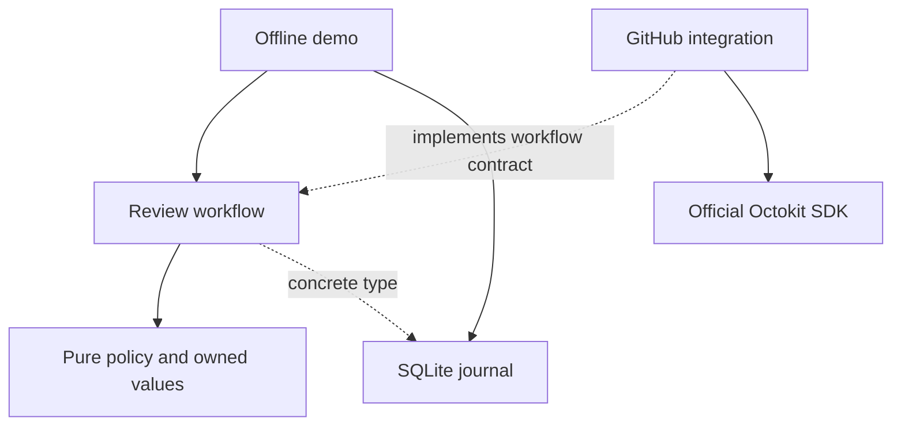

# Review publication: a small reference architecture

One capability from a hypothetical Statecraft workflow: publish feedback about an
exact infrastructure-plan artifact as a GitHub issue/PR conversation comment.
This is an executable teaching example, separate from Statecraft's implementation.

Use Node 24.12+ and npm:

```sh
cd examples/review-publication
npm ci
npm test
npm run demo
```

The demo is offline and requires no credentials. It uses real SQLite and a
simulated GitHub boundary. Output:

```text
Response lost: unknown
Repeat request: unknown
Read back evidence: published
Comments created: 1
```

Node may print its experimental SQLite warning. TypeScript runs through Node's
native type stripping; `npm test` also runs the type checker.

## Read the capability in this order

| File | Responsibility | Why it exists |
| --- | --- | --- |
| `policy.ts` | Values in, publication decision out | Challenge the rule without a database or network |
| `workflow.ts` | Decide, reserve, publish, reconcile | Make effect order and uncertainty visible |
| `journal.ts` | Concrete SQLite attempt journal | Preserve uncertainty across restart; reserve one writer |
| `github.ts` | Official Octokit integration | Contain SDK types, pagination, and evidence matching |
| `demo.ts` | Explicit composition | Wire the capability without a container or framework |

The `GitHubComments` contract belongs to the workflow that consumes it. It earns
its cost by allowing a provider-accepted write with a lost response to be reproduced.
The concrete journal and hash utility have no additional interfaces.



Arrows represent source dependencies; dashed arrows are type-only imports. The
workflow receives its effectful collaborators as ordinary arguments. Runtime
control flows from workflow to GitHub integration even though the integration
depends on the workflow's small contract.

## The live integration has one ordinary composition point

`github.ts` uses the official `@octokit/rest` SDK; there is no handwritten HTTP
client. A host application would construct these values and call `publishReview`
from its authenticated entry point:

```ts
const client = new Octokit({
  auth: process.env.GITHUB_TOKEN,
  request: { timeout: 10_000 },
});
const github = githubComments(client, configuredPublisherUserId);
const journal = new PublicationJournal("reviews.sqlite");
```

`configuredPublisherUserId` must identify the authenticated publishing account.
Reconciliation matches its author ID and the entire expected comment body, across
all pages. The marker is correlation data, not authorization or a GitHub-enforced
idempotency key. Keep this client free of automatic write-retry middleware.

## Properties and limits

- Stale or empty feedback is skipped. Every published body names the exact plan.
- A stable review ID identifies immutable content. Editing it requires a new ID;
  reuse with changed text or plan is rejected for the same destination.
- The SQLite unique key reserves an attempt before the external call. Workers
  must share the same durable journal. Losing or deleting it loses deduplication.
- An unconfirmed create stays `unknown`, including after restart. Repeating the
  request never makes a second create through this workflow and journal.
- Reconciliation reads evidence. An exact match from the configured publisher
  confirms publication; absence leaves it unknown. Lookup errors propagate.
- A crash after reservation but before sending can permanently leave an unsent
  comment unknown. This deliberately gives up automatic eventual delivery.

The tests challenge stale-plan rejection, known and unknown outcomes across a
database reopen, competing connections, immutable identity, and the real SDK's
request mapping and pagination using simulated HTTP responses. They do not verify
live GitHub behavior or real disk-failure durability.

This capability publishes context; it does not authorize or apply infrastructure.
The current-plan check uses a supplied snapshot. A newly created plan cannot make
the comment authorize that new plan. Authorizing an apply would require an atomic
binding to the exact approved artifact at execution.

A production host must supply authentication, authorization, ingress validation,
an authoritative plan snapshot, bounded input sizes, credential lifecycle,
diagnostics, database operations, and an explicit resolution path for unknown
attempts. Those belong to the host and the publication capability; they cannot be
inferred from a passing pure-policy test.
